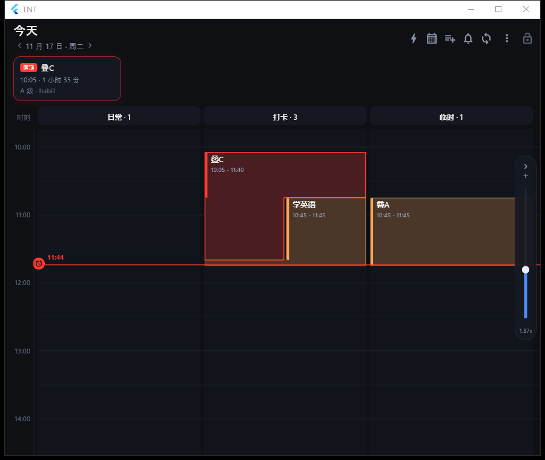
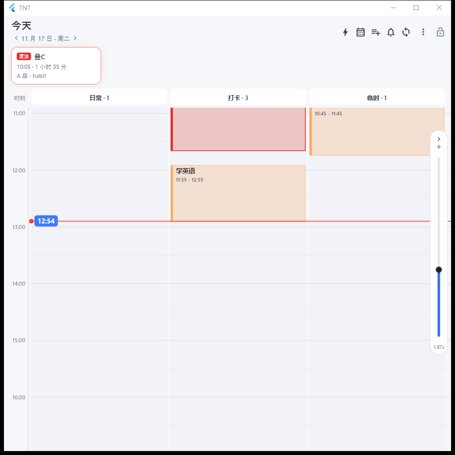
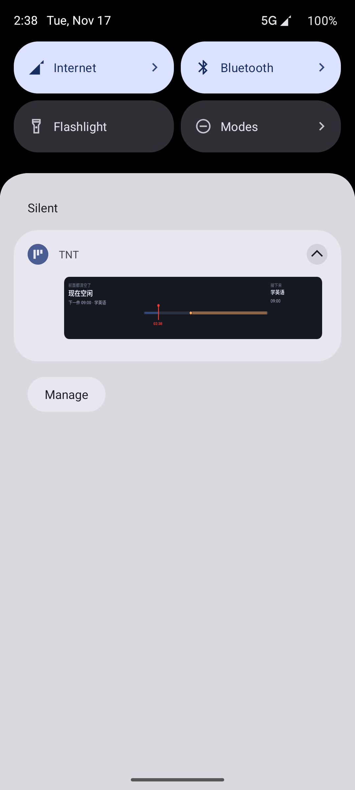

# TNT — 一天时间轴上的方块事件管理

把「今天要做什么」画成一条**可拖的纵向时间轴**：三层泳道（日常 / 打卡 / 临时）、方块就是事件、拖一下就改时间。Android + Windows 双端，数据可以在同一 Wi-Fi 下直接同步。

TNT turns your day into a drag-and-drop timeline: three swimlanes, one block per event, reminders, a live "metro map" status strip on phone and desktop, and LAN sync between your own devices. UI is Chinese; the code and docs are bilingual-friendly.

## 截图

| 时间轴（深色） | 时间轴（浅色） |
| --- | --- |
|  |  |

| 手机通知栏的时间条 | 4×1 桌面小组件 |
| --- | --- |
|  |  |

## 现在能做什么

| 模块 | 能力 |
| --- | --- |
| 时间轴 | 三泳道并行、重叠自动分列、5 分钟吸附、双指缩放 / 右侧滑块、现在时刻四种标识（胶囊 / 箭头 / 指针 / 手绘图案，颜色大小位置线宽可调） |
| 编辑 | 长按拿起拖动（换时间 / 换泳道 / 拖到顶部换日期）、上下把手改起止、拖动面板（开始 / 结束 / 位置三条滑块）、编辑面板（标题 / 时长 / 优先级 / 泳道 / 死线 / 备注）、双击快速调整 |
| 组织 | 合集（一件套多件，一键投入某天）、重复任务（按星期掩码物化）、收件箱 / 组合台（先记下来再排）、全局搜索 |
| 提醒 | 到点通知（Android 精确闹钟 / Windows 原生 Toast）、提前量、免打扰时段、仅工作日 |
| 时间条 | 通知栏常驻线路图 + 4×1 桌面小组件 + Windows 右下角悬浮条，红线随当前时间走 |
| 数据 | 本地 SQLite（drift）、局域网全量同步（LWW + 墓碑）、JSON 备份 / 恢复、跨天顺延 / 晚间小结、完成记录 + 连续打卡 |
| 外观 | 深色 / 浅色 / 跟随系统、界面字号四档、泳道自定义（增删改排序）、手柄粗细、泳道间距、首次启动引导 |

## 功能入口速查

- 顶栏：日期翻页、日历、库（合集 / 重复任务）、提醒设置、同步、更多菜单（收尾 / 搜索 / 完成记录 / 隐藏泳道 / 缩放滑块 / 设置 / 清空）
- 手机底栏：时间轴 / 收件箱 / 日历 / 库
- 设置：手感、界面（主题 / 字号 / 时刻标识 / 缩放滑块）、交互（新建方式 / 优先级选择 / 时间选择器）、泳道、常驻显示、提醒与同步、数据（备份）

## 目录结构

```
lib/
  core/            色板、时间工具
  data/            drift 数据库、仓库、同步、备份
  domain/          模型（TBlock / Lane / Priority）、布局算法、时间条渲染、解析器
  features/        timeline / calendar / library / composer / search / settings / onboarding …
  platform/        通知调度、时间条通道、快捷动作
android/           Kotlin：前台服务时间条、小组件、通知动作
windows/runner/    原生 Toast、悬浮时间条窗口
test/              189 项单元 / 组件测试
```

## 开发与构建

```bash
# 环境：Flutter 3.50+ / Dart 3.14+ / JDK 17 / Android SDK 37 / VS 2022 + ATL
flutter pub get
flutter analyze
flutter test

flutter build windows --debug
flutter build apk --release --split-per-abi
```

一键构建（推荐）：

```powershell
pwsh -File tool/build.ps1            # analyze + test + apk + windows + 打包 zip
pwsh -File tool/build.ps1 -SkipTest  # 跳过测试
```

产物落在 `dist/`：`tnt-<version>-arm64-release.apk`、`tnt-<version>-armv7-release.apk`、`tnt-<version>-windows-x64.zip`。

## 正式签名

`android/key.properties`（已在 `.gitignore` 里）指向 keystore：

```properties
storePassword=***
keyPassword=***
keyAlias=tnt
storeFile=E:/TNT/keystore/tnt-release.jks
```

文件不存在时自动退回 debug 签名（`flutter run` 照常可用）。发布前请换成你自己的 keystore —— **keystore 丢了就再也升不了级**。

## 版本

- 版本号在 `pubspec.yaml` 的 `version: 0.2.0+30`（语义版本 + versionCode）
- 升级安装的 versionCode 必须大于已装版本；从 debug 签名换正式签名需要先卸载旧包

## 已知限制

- Windows 的系统 Toast 需要正式安装的快捷方式（绿色版需先运行一次）
- 托盘图标在 Win10 会进溢出区（系统行为）
- 桌面端关闭程序后：悬浮时间条消失、提醒不再触发（托盘常驻时仍工作）
- 局域网同步需要两台设备在同一网段，配对码手动输入

## 许可证

MIT，见 [LICENSE](LICENSE)。
